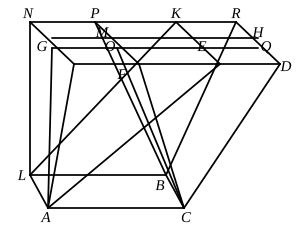

Let ">$CM$, ">$CN$ be parallelepipedal solids on the same base ">$AB$ and of the same height, and let the extremities of their sides which stand up, namely $AF$, $AG$, $LM$, $LN$, $CD$, $CE$, $BH$, $BK$, not be on the same straight lines;  
I say that the solid ">$CM$ is equal to the solid ">$CN$.

For let $NK$, $DH$ be produced and meet one another at $R$, and further let $FM$, $GE$ be produced to $P$, $Q$;  
let $AO$, $LP$, $CQ$, $BR$ be joined.

Then the solid ">$CM$, of which the parallelogram ">$ACBL$ is the base, and ">$FDHM$ its opposite, is equal to the solid ">$CP$, of which the parallelogram ">$ACBL$ is the base, and ">$OQRP$ its opposite;  
for they are on the same base ">$ACBL$ and of the same height, and the extremities of their sides which stand up, namely $AF$, $AO$, $LM$, $LP$, $CD$, $CQ$, $BH$, $BR$, are on the same straight lines $FP$, $DR$. [XI. 29]

But the solid ">$CP$, of which the parallelogram ">$ACBL$ is the base, and ">$OQRP$ its opposite, is equal to the solid ">$CN$, of which the parallelogram ">$ACBL$ is the base and ">$GEKN$ its opposite;  
for they are again on the same base ">$ACBL$ and of the same height, and the extremities of their sides which stand up, namely $AG$, $AO$, $CE$, $CQ$, $LN$, $LP$, $BK$, $BR$, are on the same straight lines $GQ$, $NR$.

Hence the solid ">$CM$ is also equal to the solid ">$CN$.

Therefore etc.

Q. E. D.

---

This proposition completes the proof of the theorem that  
*Two parallelepipeds on the same base and of the same height are equivalent.*

Legendre deduced the useful theorem that  
*Every parallelepiped can be changed into an equivalent rectangular parallelepiped having the same height and an equivalent base.*

For suppose we have a parallelepiped on the base ">$ABCD$ with ">$EFGH$ for the opposite face.
