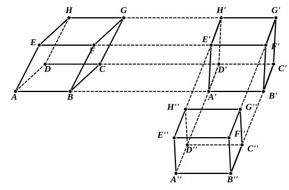

Draw $AI$, $BK$, $CL$, $DM$ perpendicular to the plane through ">$EFGH$ and 
all equal to the height of the parallelepiped ">$AG$. Then, on joining $IK$, $KL$, 
$LM$, $MI$, we have a parallelepiped equivalent to the original one and having 
its lateral faces ">$AK$, ">$BL$, ">$CM$, ">$DI$ rectangles.

If ">$ABCD$ is not a rectangle, draw $AO$, $DN$ in the plane ">$AC$ perpendicu- 
lar to $BC$, and $IP$, $MQ$ in the plane ">$IL$ perpendicular to $KL$.

Joining $OP$, $NQ$, we have a rectangular parallelepiped on ">$AOND$ as base 
which is equivalent to the parallelepiped with ">$ABCD$ as base and ">$IKLM$ as 
opposite face, since we may regard these parallelepipeds as being on the same 
base ">$ADMI$ and of the same height ($AO$).

That is, a rectangular parallelepiped has been constructed which is 
equivalent to the given parallelepiped and has (1) the same height, (2) an 
equivalent base.

The American text-books which I have quoted adopt a somewhat different 
construction shown in the subjoined figure.

The edges $AB$, $DC$, $EF$, $HG$ of the original parallelepiped are produced 
and cut at right angles by two parallel planes at a distance apart $A'B'$ equal 
to $AB$.

Thus a parallelepiped is formed in which all the faces are rectangles except 
">$A'H'$, ">$B'G'$.
