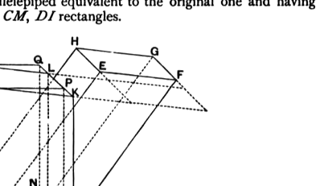
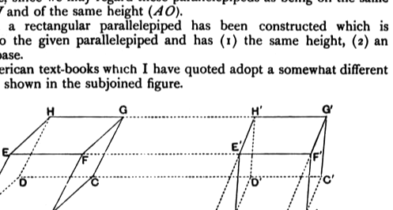

Draw *AI*, *BK*, *CL*, *DM* perpendicular to the plane through *EFGH* and all equal to the height of the parallelepiped *AG*. Then, on joining *IK*, *KL*, *LM*, *MI*, we have a parallelepiped equivalent to the original one and having its lateral faces *AK*, *BL*, *CM*, *DI* rectangles.

If *ABCD* is not a rectangle, draw *AO*, *DN* in the plane *AC* perpendicular to *BC*, and *IP*, *MQ* in the plane *IL* perpendicular to *KL*.

Joining *OP*, *NQ*, we have a rectangular parallelepiped on *AOND* as base which is equivalent to the parallelepiped with *ABCD* as base and *IKLM* as opposite face, since we may regard these parallelepipeds as being on the same base *ADMI* and of the same height (*AO*).

That is, a rectangular parallelepiped has been constructed which is equivalent to the given parallelepiped and has (1) the same height, (2) an equivalent base.

The American text-books which I have quoted adopt a somewhat different construction shown in the subjoined figure.

The edges *AB*, *DC*, *EF*, *HG* of the original parallelepiped are produced and cut at right angles by two parallel planes at a distance apart *A'B'* equal to *AB*.

Thus a parallelepiped is formed in which all the faces are rectangles except *A'H'*, *B'G'*.
