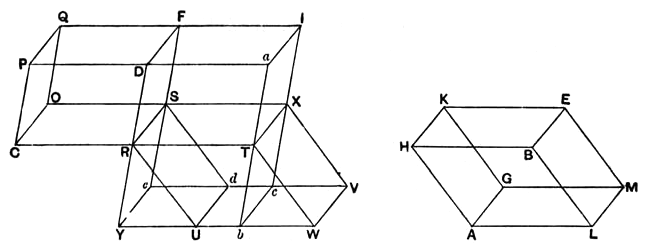

Next produce *D'A'*, *C'B'*, *G'F'*, *H'E'* and cut them perpendicularly by two parallel planes at a distance apart *B''C''* equal to *B'C'*.

The points of section determine a rectangular parallelepiped.

The equivalence of the three parallelepipeds is proved, not by Eucl. XI. 29, 30, but by the proposition about a right section of a prism given above in the note to XI. 28 (3 in that note).

---

### PROPOSITION 31.

*Parallelepipedal solids which are on equal bases and of the same height are equal to one another.*

Let the parallelepipedal solids *AE*, *CF*, of the same height, be on equal bases *AB*, *CD*.

I say that the solid *AE* is equal to the solid *CF*.

First, let the sides which stand up, *HK*, *BE*, *AG*, *LM*, *PQ*, *DF*, *CO*, *RS*, be at right angles to the bases *AB*, *CD*;
let the straight line *RT* be produced in a straight line with *CR*;
on the straight line *RT*, and at the point *R* on it, let the angle *TRU* be constructed equal to the angle *ALB*, [I. 23]
let *RT* be made equal to *AL*, and *RU* equal to *LB*,
and let the base *RW* and the solid *XU* be completed.

Now, since the two sides *TR*, *RU* are equal to the two sides *AL*, *LB*,
and they contain equal angles,
therefore the parallelogram *RW* is equal and similar to the parallelogram *HL*.

Since again *AL* is equal to *RT*, and *LM* to *RS*,
and they contain right angles,
