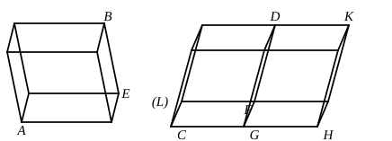

into the text. He is correct in his remark that the words “while the 
extremities of their sides which stand up are not on the same straight lines” 
just before the end of the proposition would be better absent, since they *may* 
be “on the same straight lines.”

---

### PROPOSITION 32.

Parallelepipedal solids which are of the same height are to 
one another as their bases.

Let ">$AB$, ">$CD$ be parallelepipedal solids of the same height; 
I say that the parallelepipedal solids ">$AB$, ">$CD$ are to one 
another as their bases, that is, that, as the base ">$AE$ is to the 
base ">$CF$, so is the solid ">$AB$ to the solid ">$CD$.

For let ">$FH$ equal to ">$AE$ be applied to $FG$, [I. 45] 
and on ">$FH$ as base, and with the same height as that of ">$CD$, 
let the parallelepipedal solid ">$GK$ be completed.

Then the solid ">$AB$ is equal to the solid ">$GK$; 
for they are on equal bases ">$AE$, ">$FH$ and of the same height. 
[XI. 31]

And, since the parallelepipedal solid ">$CK$ is cut by the plane 
">$DG$ which is parallel to opposite planes,

therefore, as the base ">$CF$ is to the base ">$FH$, so is the solid 
">$CD$ to the solid ">$DH$. [XI. 25]

But the base ">$FH$ is equal to the base ">$AE$, 
and the solid ">$GK$ to the solid ">$AB$;

therefore also, as the base ">$AE$ is to the base ">$CF$, so is the 
solid ">$AB$ to the solid ">$CD$.

Therefore etc.Q. E. D.

---

As Clavius observed, Euclid should have said, in applying the parallelo- 
gram ">$FH$ to $FG$, that it should be applied “in the angle $FGH$ equal to the 
angle $LCG$.” Simson is however, I think, hypercritical when he states as 
regards the completion of the solid ">$GK$ that it ought to be said, “complete
