the solid of which the base is ">$FH$, and one of its insisting straight lines is $FD$." Surely, when we have two faces ">$DG$, ">$FH$ meeting in an edge, to say "complete the solid" is quite sufficient, though the words "on ">$FH$ as base" might perhaps as well be left out. The same "completion" of a parallelepipedal solid occurs in XI. 31 and 33.

---

### PROPOSITION 33.

*Similar parallelepipedal solids are to one another in the triplicate ratio of their corresponding sides.*

Let ">$AB$, ">$CD$ be similar parallelepipedal solids,
and let $AE$ be the side corresponding to $CF$;
I say that the solid ">$AB$ has to the solid ">$CD$ the ratio triplicate of that which $AE$ has to $CF$.

For let $EK$, $EL$, $EM$ be produced in a straight line with $AE$, $GE$, $HE$,
let $EK$ be made equal to $CF$, $EL$ equal to $FN$, and further $EM$ equal to $FR$,
and let the parallelogram ">$KL$ and the solid ">$KP$ be completed.

Now, since the two sides $KE$, $EL$ are equal to the two sides $CF$, $FN$,
while the angle $KEL$ is also equal to the angle $CFN$, inasmuch as the angle $AEG$ is also equal to the angle $CFN$ because of the similarity of the solids ">$AB$, ">$CD$,
