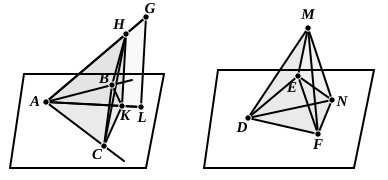

### PROPOSITION 35.

If there be two equal plane angles, and on their vertices 
there be set up elevated straight lines containing equal angles 
with the original straight lines respectively, if on the elevated 
straight lines points be taken at random and perpendiculars be 
drawn from them to the planes in which the original angles 
are, and if from the points so arising in the planes straight 
lines be joined to the vertices of the original angles, they will 
contain, with the elevated straight lines, equal angles.

Let the angles $BAC$, $EDF$ be two equal rectilineal angles, 
and from the points $A$, $D$ let the elevated straight lines $AG$, 
$DM$ be set up containing, with the original straight lines, 
equal angles respectively, namely, the angle $MDE$ to the 
angle $GAB$ and the angle $MDF$ to the angle $GAC$, 
let points $G$, $M$ be taken at random on $AG$, $DM$, 
let $GL$, $MN$ be drawn from the points $G$, $M$ perpendicular to 
the planes through $BA$, $AC$ and $ED$, $DF$, and let them meet 
the planes at $L$, $N$, 
and let $LA$, $ND$ be joined ; 
I say that the angle $GAL$ is equal to the angle $MDN$.

Let $AH$ be made equal to $DM$, 
and let $HK$ be drawn through the point $H$ parallel to $GL$.

But $GL$ is perpendicular to the plane through $BA$, $AC$;

therefore $HK$ is also perpendicular to the plane through 
$BA$, $AC$. [XI. 8]

From the points $K$, $N$ let $KC$, $NF$, $KB$, $NE$ be drawn 
perpendicular to the straight lines $AC$, $DF$, $AB$, $DE$, 
and let $HC$, $CB$, $MF$, $FE$ be joined.
