let each of the straight lines *DE*, *GE*, *EF* be made equal to
*B*, and let the parallelepipedal solid *EK* be completed,
let *LM* be made equal to *A*,
and on the straight line *LM*, and at the point *L* on it, let there
be constructed a solid angle equal to the solid angle at *E*,
namely that contained by *NLO*, *OLM*, *MLN*;
let *LO* be made equal to *B*, and *LN* equal to *C*.

Now, since, as *A* is to *B*, so is *B* to *C*,
while *A* is equal to *LM*, *B* to each of the straight lines *LO*,
*ED*, and *C* to *LN*,
therefore, as *LM* is to *EF*, so is *DE* to *LN*.

Thus the sides about the equal angles *NLM*, *DEF* are
reciprocally proportional;
therefore the parallelogram *MN* is equal to the parallelogram
*DF*. [VI. 14]

And, since the angles *DEF*, *NLM* are two plane recti-
lineal angles, and on them the elevated straight lines *LO*, *EG*
are set up which are equal to one another and contain equal
angles with the original straight lines respectively,
therefore the perpendiculars drawn from the points *G*, *O* to
the planes through *NL*, *LM* and *DE*, *EF* are equal to one
another; [XI. 35, Por.]
hence the solids *LH*, *EK* are of the same height.

But parallelepipedal solids on equal bases and of the same
height are equal to one another; [XI. 31]
therefore the solid *HL* is equal to the solid *EK*.

And *LH* is the solid formed out of *A*, *B*, *C*, and *EK* the
solid on *B*;
