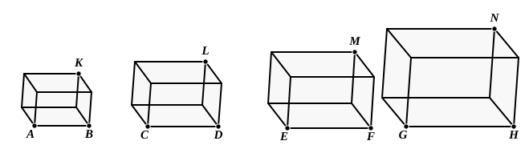

therefore the parallelepipedal solid formed out of *A*, *B*, *C* is
equal to the solid on *B* which is equilateral, but equiangular
with the aforesaid solid.

Q. E. D.

---

The edges of the parallelepiped *HL* being respectively equal to *A*, *B*, *C*,
and those of the equiangular parallelepiped *KE* being all equal to *B*, we
regard *MN* (*not* containing the edge *OL* equal to *B*) as the base of the first
parallelepiped, and consequently *FD*, equiangular to *MN*, as the base of *KE*.
    Then the solids have the same height. [XI. 35, Por.]
    Hence
$$\text{(solid } HL\text{)} : \text{(solid } KE\text{)} = \mathbin{▱} MN : \mathbin{▱} FD.$$ [XI. 32]
    But, since *A*, *B*, *C* are in continued proportion,
$$A : B = B : C,$$
or
$$LM : EF = DE : LN.$$
    Thus the sides of the equiangular ▱s *MN*, *FD* are reciprocally pro-
portional, whence
$$\mathbin{▱} MN = \mathbin{▱} FD,$$ [VI. 14]
and therefore
$$\text{(solid } HL\text{)} = \text{(solid } KE\text{)}.$$

---

### PROPOSITION 37.

*If four straight lines be proportional, the parallelepipedal
solids on them which are similar and similarly described will
also be proportional; and, if the parallelepipedal solids on them
which are similar and similarly described be proportional, the
straight lines will themselves also be proportional.*

Let *AB*, *CD*, *EF*, *GH* be four straight lines in proportion,
so that, as *AB* is to *CD*, so is *EF* to *GH*;
and let there be described on *AB*, *CD*, *EF*, *GH* the similar
and similarly situated parallelepipedal solids *KA*, *LC*, *ME*,
*NG*;
I say that, as *KA* is to *LC*, so is *ME* to *NG*.

For, since the parallelepipedal solid *KA* is similar to *LC*,
therefore *KA* has to *LC* the ratio triplicate of that which *AB*
has to *CD*. [XI. 33]
