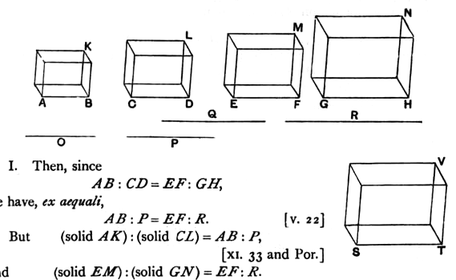

For the same reason
*ME* also has to *NG* the ratio triplicate of that which *EF* has
to *GH*. [*id.*]

And, as *AB* is to *CD*, so is *EF* to *GH*.

Therefore also, as *AK* is to *LC*, so is *ME* to *NG*.

Next, as the solid *AK* is to the solid *LC*, so let the solid
*ME* be to the solid *NG*;
I say that, as the straight line *AB* is to *CD*, so is *EF* to *GH*.

For since, again, *KA* has to *LC* the ratio triplicate of that
which *AB* has to *CD*, [XI. 33]
and *ME* also has to *NG* the ratio triplicate of that which *EF*
has to *GH*, [*id.*]
and, as *KA* is to *LC*, so is *ME* to *NG*,
therefore also, as *AB* is to *CD*, so is *EF* to *GH*.

Therefore etc.

Q. E. D.

---

In this proposition it is assumed that, if two ratios be equal, the ratio
triplicate of one is equal to the ratio triplicate of the other and, conversely,
that, if ratios which are the triplicate of two other ratios are equal, those other
ratios are themselves equal.

To avoid the necessity for these assumptions Simson adopts the alternative
proof found in the MS. which Heiberg calls **b**, and also adopted by Clavius,
who, however, gives Euclid's proof as well, attributing it to Theon. The
alternative proof proceeds after the manner of VI. 22, thus.

Make *AB*, *CD*, *O*, *P* continuous proportionals, and also *EF*, *GH*, *Q*, *R*.

I. Then, since
$$AB : CD = EF : GH,$$
we have, *ex aequali*,
$$AB : P = EF : R.$$ [V. 22]
    But
$$\text{(solid } AK\text{)} : \text{(solid } CL\text{)} = AB : P,$$ [XI. 33 and Por.]
and
$$\text{(solid } EM\text{)} : \text{(solid } GN\text{)} = EF : R.$$
    Therefore
$$\text{(solid } AK\text{)} : \text{(solid } CL\text{)} = \text{(solid } EM\text{)} : \text{(solid } GN\text{)}$$
