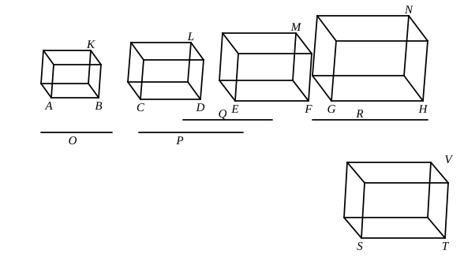

For the same reason 
">$ME$ also has to ">$NG$ the ratio triplicate of that which $EF$ has 
to $GH$. [*id.*]

And, as $AB$ is to $CD$, so is $EF$ to $GH$.

Therefore also, as ">$AK$ is to ">$LC$, so is ">$ME$ to ">$NG$.

Next, as the solid ">$AK$ is to the solid ">$LC$, so let the solid 
">$ME$ be to the solid ">$NG$; 
I say that, as the straight line $AB$ is to $CD$, so is $EF$ to $GH$.

For since, again, ">$KA$ has to ">$LC$ the ratio triplicate of that 
which $AB$ has to $CD$, [XI. 33] 
and ">$ME$ also has to ">$NG$ the ratio triplicate of that which $EF$ 
has to $GH$, [*id.*] 
and, as ">$KA$ is to ">$LC$, so is ">$ME$ to ">$NG$,

therefore also, as $AB$ is to $CD$, so is $EF$ to $GH$.

Therefore etc.

Q. E. D.

---

In this proposition it is assumed that, if two ratios be equal, the ratio 
triplicate of one is equal to the ratio triplicate of the other and, conversely, 
that, if ratios which are the triplicate of two other ratios are equal, those other 
ratios are themselves equal.

To avoid the necessity for these assumptions Simson adopts the alternative 
proof found in the MS. which Heiberg calls **b**, and also adopted by Clavius, 
who, however, gives Euclid's proof as well, attributing it to Theon. The 
alternative proof proceeds after the manner of VI. 22, thus.

Make $AB$, $CD$, $O$, $P$ continuous proportionals, and also $EF$, $GH$, $Q$, $R$.

I. Then, since
$$AB : CD = EF : GH,$$
we have, *ex aequali*,
$$AB : P = EF : R. \qquad \text{[V. 22]}$$
    But
$$\text{(solid } AK\text{)} : \text{(solid } CL\text{)} = AB : P, \qquad \text{[XI. 33 and Por.]}$$
and
$$\text{(solid } EM\text{)} : \text{(solid } GN\text{)} = EF : R.$$
    Therefore
$$\text{(solid } AK\text{)} : \text{(solid } CL\text{)} = \text{(solid } EM\text{)} : \text{(solid } GN\text{)}$$
