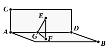

II. If the solids are proportional, take *ST* such that
$$AB : CD = EF : ST,$$
and on *ST* describe the parallelepiped *SV* similar and similarly situated to
either of the parallelepipeds *EM*, *GN*.
    Then, by the first part,
$$\text{(solid } AK\text{)} : \text{(solid } CL\text{)} = \text{(solid } EM\text{)} : \text{(solid } SV\text{)},$$
whence it follows that
$$\text{(solid } GN\text{)} = \text{(solid } SV\text{)}.$$
    But these solids are similar and similarly situated;
therefore their faces are similar and equal; [XI. Def. 10]
therefore the corresponding sides *GH*, *ST* are equal.
    [For this inference cf. note on VI. 22. The equality of *GH*, *ST* may
readily be proved by application of the two parallelepipeds to one another,
since, being similar, they are equiangular.]
    Hence
$$AB : CD = EF : GH.$$

---

The text of the MSS. has here a proposition which is as badly placed as it
is unnecessary. *If a plane be at right angles to a plane, and from any one of the
points in one of the planes a perpendicular be drawn to the other plane, the
perpendicular so drawn will fall on the common section of the planes.* It is of
the nature of a lemma to XII. 17, where
alone the fact is made use of. Heiberg
observes that it is omitted in **b** and that the
copyist of **P** knew other texts which did not
contain it. From these facts it is fairly con-
cluded that the proposition was interpolated.
The truth of it is of course immediately
obvious by *reductio ad absurdum*. Let the plane *CAD* be perpendicular to
the plane *AB*, and let a perpendicular be drawn to the latter from any point
*E* in the former.

If it does not fall on *AD*, the common section, let it meet the plane *AB*
in *F*.

Draw *FG* in *AB* perpendicular to *AD*, and join *EG*.

Then *FG* is perpendicular to the plane *CAD* [XI. Def. 4], and therefore
to *GE* [XI. Def. 3]. Therefore $\angle EGF$ is right.

Also, since *EF* is perpendicular to *AB*,
the angle *EFG* is right.

That is, the triangle *EGF* has two right angles:
which is impossible.

---

### PROPOSITION 38.

*If the sides of the opposite planes of a cube be bisected, and
planes be carried through the points of section, the common
section of the planes and the diameter of the cube bisect one
another.*

For let the sides of the opposite planes *CF*, *AH* of the
cube *AF* be bisected at the points *K*, *L*, *M*, *N*, *O*, *Q*, *P*, *R*,
