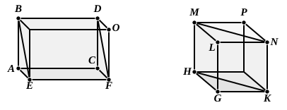

Therefore [I. 26] the triangles ">$DTU$, ">$GTS$ are equal in all respects, so that
$$DT = TG,$$
$$UT = TS.$$

---

### PROPOSITION 39.

*If there be two prisms of equal height, and one have a
parallelogram as base and the other a triangle, and if the
parallelogram be double of the triangle, the prisms will be
equal.*

Let ">$ABCDEF$, ">$GHKLMN$ be two prisms of equal
height,
let one have the parallelogram ">$AF$ as base, and the other the
triangle ">$GHK$,
and let the parallelogram ">$AF$ be double of the triangle ">$GHK$;
I say that the prism ">$ABCDEF$ is equal to the prism
">$GHKLMN$.

For let the solids ">$AO$, ">$GP$ be completed.

Since the parallelogram ">$AF$ is double of the triangle ">$GHK$,
while the parallelogram ">$HK$ is also double of the triangle
">$GHK$, [I. 34]
therefore the parallelogram ">$AF$ is equal to the parallelogram
">$HK$.

But parallelepipedal solids which are on equal bases and
of the same height are equal to one another; [XI. 31]
therefore the solid ">$AO$ is equal to the solid ">$GP$.

And the prism ">$ABCDEF$ is half of the solid ">$AO$,
and the prism ">$GHKLMN$ is half of the solid ">$GP$; [XI. 28]
therefore the prism ">$ABCDEF$ is equal to the prism
">$GHKLMN$.

Therefore etc.

Q. E. D.
