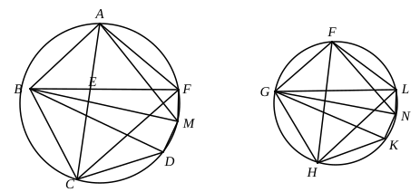

# BOOK XII. PROPOSITIONS.

## PROPOSITION 1.

*Similar polygons inscribed in circles are to one another as the squares on the diameters.*

Let *ABC*, *FGH* be circles,
let *ABCDE*, *FGHKL* be similar polygons inscribed in them,
and let *BM*, *GN* be diameters of the circles;
I say that, as the square on *BM* is to the square on *GN*, so is the polygon *ABCDE* to the polygon *FGHKL*.

For let *BE*, *AM*, *GL*, *FN* be joined.
Now, since the polygon *ABCDE* is similar to the polygon *FGHKL*,
the angle *BAE* is equal to the angle *GFL*,
and, as *BA* is to *AE*, so is *GF* to *FL*. [vi. Def. 1]
Thus *BAE*, *GFL* are two triangles which have one angle equal to one angle, namely the angle *BAE* to the angle *GFL*, and the sides about the equal angles proportional;
therefore the triangle *ABE* is equiangular with the triangle *FGL*. [vi. 6]
Therefore the angle *AEB* is equal to the angle *FLG*.
