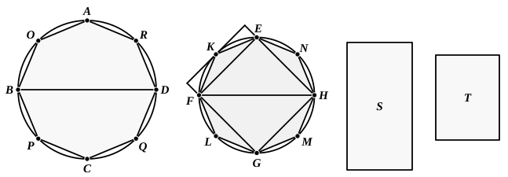

## PROPOSITION 2.

*Circles are to one another as the squares on the diameters.*

Let $ABCD$, $EFGH$ be circles, and $BD$, $FH$ their diameters;
I say that, as the circle $ABCD$ is to the circle $EFGH$, so is the square on $BD$ to the square on $FH$.

For, if the square on $BD$ is not to the square on $FH$ as the circle $ABCD$ is to the circle $EFGH$,
then, as the square on $BD$ is to the square on $FH$, so will the circle $ABCD$ be either to some less area than the circle $EFGH$, or to a greater.
First, let it be in that ratio to a less area $S$.
Let the square ">$EFGH$ be inscribed in the circle $EFGH$;
then the inscribed square is greater than the half of the circle $EFGH$, inasmuch as, if through the points $E$, $F$, $G$, $H$ we draw tangents to the circle, the square ">$EFGH$ is half the square circumscribed about the circle, and the circle is less than the circumscribed square;
hence the inscribed square ">$EFGH$ is greater than the half of the circle $EFGH$.
Let the circumferences $EF$, $FG$, $GH$, $HE$ be bisected at the points $K$, $L$, $M$, $N$,
and let $EK$, $KF$, $FL$, $LG$, $GM$, $MH$, $HN$, $NE$ be joined;
therefore each of the triangles ">$EKF$, ">$FLG$, ">$GMH$, ">$HNE$ is also greater than the half of the segment of the circle about it, inasmuch as, if through the points $K$, $L$, $M$, $N$ we draw tangents to the circle and complete the parallelograms on the straight lines $EF$, $FG$, $GH$, $HE$, each of the triangles ">$EKF$,
