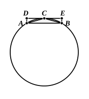

therefore, alternately, as the area $S$ is to the circle $EFGH$, so is the circle $ABCD$ to the area $T$. [v. 16]
But the area $S$ is greater than the circle $EFGH$;
therefore the circle $ABCD$ is also greater than the area $T$.
Hence, as the area $S$ is to the circle $ABCD$, so is the circle $EFGH$ to some area less than the circle $ABCD$.

**Q. E. D.**

---

Though this theorem is said to have been proved by Hippocrates, we may with tolerable certainty attribute the proof of it given by Euclid to Eudoxus, to whom XII. 7 Por. and XII. 10 (which Euclid proves in exactly the same manner) are specifically attributed by Archimedes. As regards the lemma used herein (Eucl. X. 1) and the somewhat different lemma by means of which Archimedes says that the theorems of XII. 2, XII. 7 Por. and XII. 18 were proved, see my note on X. 1 above.
The first essential in this proposition is to prove that we can _exhaust_ a circle, in the sense of X. 1, by successively inscribing in it regular polygons, each of which has twice as many sides as the preceding one. We take first an inscribed square, then bisect the arcs subtended by the sides and so form an equilateral polygon of eight sides, then do the same with the latter, forming a polygon of 16 sides, and so on. And we have to prove that what is left over when any one of these polygons is taken away from the circle is _more than half exhausted_ when the next polygon is made and subtracted from the circle.
Euclid proves that the inscribed square is greater than half the circle and that the regular octagon when subtracted takes away more than half of what was left by the square. He then infers that the same thing will happen whenever the number of sides is doubled.
This can be seen generally by taking _any_ arc of a circle cut off by a chord $AB$. Bisect the arc in $C$. Draw a tangent to the circle at $C$, and let $AD$, $BE$ be drawn perpendicular to the tangent. Join $AC$, $CB$.
Then $DE$ is parallel to $AB$, since
$\angle$$ECB$ $= \angle$$CAB$, in alternate segment, [III. 32]
$= \angle$$CBA$. [III. 29, I. 5]
Thus ">$ABED$ is a $\square$;
and it is greater than the segment $ACB$.
Therefore its half, the $\triangle$">$ACB$, is greater than half the segment.

Thus, by X. 1, Euclid's construction of successive regular polygons in a circle, if continued far enough, will at length leave segments which are together less than any given area.
Now let $X$, $X'$ be the areas of the circles, $d$, $d'$ their diameters, respectively.
Then, if
$$X : X' \ne d^2 : {d'}^2,$$
$$d^2 : {d'}^2 = X : S,$$
where $S$ is some area either greater or less than $X'$.
**I.** Suppose $S < X'$.
Continue the construction of polygons in $X'$ until we arrive at one which
