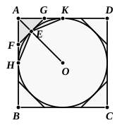

Similarly $\angle ABO = \angle A'B'O'$.
    Therefore $\triangle\text{s}$ $AOB$, $A'O'B'$ are similar, so that their areas are in the duplicate ratio of $AB$ to $A'B'$.
    The radii $OC$, $O'C'$ drawn to the points of contact are perpendicular to $AB$, $A'B'$, and it follows that
$$AB : A'B' = CO : C'O'.$$
    Thus the polygons are to one another in the duplicate ratio of the radii, and therefore of the diameters.
    Now suppose a square $ABCD$ described about a circle.
    Make an octagon described about the circle by drawing tangents at the points $E$ etc., where $OA$ etc. meet the circle.
    Then shall the tangent at $E$ cut off more than half of the area between $AK$, $AH$ and the arc $HEK$.
    For the angle $AEG$ is right, and is therefore $> \angle EAG$.

    'Therefore
$$AG > EG$$
$$> GK.$$
    Therefore
$$\triangle AGE > \triangle EGK.$$
    Similarly
$$\triangle AFE > \triangle EFH.$$
    Hence
$$\triangle AFG > \frac{1}{2}\text{ (re-entrant quadrilateral } AHEK\text{)},$$
and _a fortiori_,
$$\triangle AFG > \frac{1}{2}\text{ (area between } AH\text{, } AK\text{ and the arc)}.$$
    Thus the octagon takes from the square more than half the space between the square and the circle.
    Similarly, if a figure of 16 equal sides be circumscribed by cutting off symmetrically the corners of the octagon, it will take away more than half of the space between the octagon and circle.
    Suppose now, with the original notation, that
$$d^2 : {d'}^2 = X : S,$$
where $S$ is greater than $X'$.
    Continue the construction of circumscribed polygons about $X'$ until the total area between the polygon and the circle is less than the difference between $S$ and $X'$, i.e. till
$$S > (\text{polygon about } X') > X'.$$
    Circumscribe a similar polygon about $X$.
    Then
$$(\text{polygon about } X) : (\text{polygon about } X') = d^2 : {d'}^2$$
$$= X : S\text{, by hypothesis,}$$
and, alternately,
$$(\text{polygon about } X) : X = (\text{polygon about } X') : S.$$
    But
$$(\text{polygon about } X) > X.$$
    Therefore
$$(\text{polygon about } X') > S.$$
    But
$$S > (\text{polygon about } X'): \qquad \text{[above]}$$
which is impossible.
    Hence $S$ cannot be _greater_ than $X'$.
