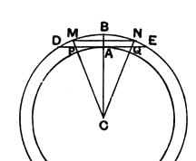
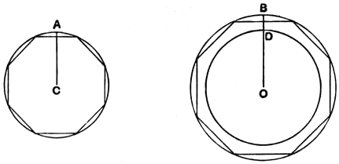

    Legendre proves this proposition by a method equally rigorous but not, I think, possessing any advantages over Euclid's. It depends on a lemma corresponding to Eucl. XII. 16, but with another part added to it.
    _Two concentric circles being given, we can always inscribe in the greater a regular polygon such that its sides do not meet the circumference of the lesser, and we can also circumscribe about the lesser a regular polygon such that its sides do not meet the circumference of the greater._
    Let $CA$, $CB$ be the radii of the circles.
    **I.** At $A$ on the inner circle draw the tangent $DE$ meeting the outer circle in $D$, $E$.
    Inscribe in the outer circle any of the regular polygons which we can inscribe, e.g. a square.
    Bisect the arc subtended by a side, bisect the half, bisect that again, and so on, until we arrive at an arc less than the arc $DBE$.
    Let this arc be $MN$, and suppose it so placed that $B$ is its middle point.
    Then the chord $MN$ is clearly more distant from the centre $C$ than $DE$ is; and the regular polygon, of which $MN$ is a side, does not anywhere meet the circumference of the inner circle.

    **II.** Join $CM$, $CN$, meeting $DE$ in $P$, $Q$.
    Then $PQ$ will be the side of a polygon circumscribed about the inner circle and similar to the polygon inscribed in the outer;
and the circumscribed polygon of which $PQ$ is a side will not anywhere meet the outer circle.
    Legendre now proves XII. 2 after the following manner.
    For brevity, let us denote the area of the circle with radius $CA$ by $(\text{circ. } CA)$.
    Then it is required to prove that, if $OB$ be the radius of a second circle,
$$(\text{circ. } CA) : (\text{circ. } OB) = CA^2 : OB^2.$$

    Suppose, if possible, that this relation is not true. Then $CA^2$ will be to $OB^2$ as $(\text{circ. } CA)$ is to an area greater or less than $(\text{circ. } OB)$.
    **I.**  Suppose, first, that
$$CA^2 : OB^2 = (\text{circ. } CA) : (\text{circ. } OD),$$
where $OD$ is less than $OB$.
