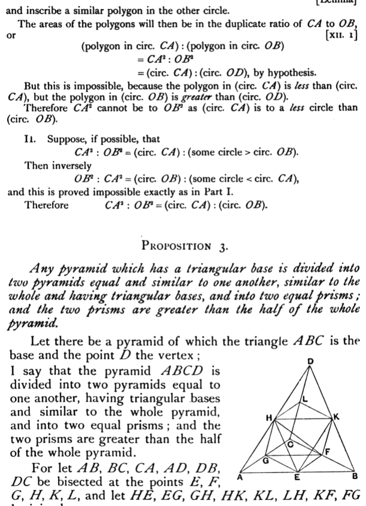

    Inscribe in the circle with radius $OB$ a regular polygon such that its sides do not anywhere meet the circumference of the circle with centre $OD$;
                                    [Lemma]
and inscribe a similar polygon in the other circle.
    The areas of the polygons will then be in the duplicate ratio of $CA$ to $OB$, or
                                    [XII. 1]
$$(\text{polygon in circ. } CA) : (\text{polygon in circ. } OB)$$
$$= CA^2 : OB^2$$
$$= (\text{circ. } CA) : (\text{circ. } OD)\text{, by hypothesis.}$$
    But this is impossible, because the polygon in $(\text{circ. } CA)$ is less than $(\text{circ. } CA)$, but the polygon in $(\text{circ. } OB)$ is greater than $(\text{circ. } OD)$.
    Therefore $CA^2$ cannot be to $OB^2$ as $(\text{circ. } CA)$ is to a less circle than $(\text{circ. } OB)$.
    **II.**  Suppose, if possible, that
$$CA^2 : OB^2 = (\text{circ. } CA) : (\text{some circle} > \text{circ. } OB).$$
    Then inversely
$$OB^2 : CA^2 = (\text{circ. } OB) : (\text{some circle} < \text{circ. } CA),$$
and this is proved impossible exactly as in Part I.
    Therefore
$$CA^2 : OB^2 = (\text{circ. } CA) : (\text{circ. } OB).$$

---

### PROPOSITION 3.

_Any pyramid which has a triangular base is divided into two pyramids equal and similar to one another, similar to the whole and having triangular bases, and into two equal prisms; and the two prisms are greater than the half of the whole pyramid._

    Let there be a pyramid of which the triangle _ABC_ is the base and the point _D_ the vertex;
I say that the pyramid _ABCD_ is divided into two pyramids equal to one another, having triangular bases and similar to the whole pyramid, and into two equal prisms; and the two prisms are greater than the half of the whole pyramid.
    For let _AB_, _BC_, _CA_, _AD_, _DB_, _DC_ be bisected at the points _E_, _F_, _G_, _H_, _K_, _L_, and let _HE_, _EG_, _GH_, _HK_, _KL_, _LH_, _KF_, _FG_ be joined.
    Since _AE_ is equal to _EB_, and _AH_ to _DH_,
therefore _EH_ is parallel to _DB_.
                                    [VI. 2]

