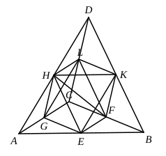

Inscribe in the circle with radius $OB$ a regular polygon such that its sides do not anywhere meet the circumference of the circle with radius $OD$; [Lemma]
and inscribe a similar polygon in the other circle.
The areas of the polygons will then be in the duplicate ratio of $CA$ to $OB$, or [XII. 1]
$(\text{polygon in circ. }$ $CA$$) : (\text{polygon in circ. }$ $OB$$)$
$=$ $CA^2$ $:$ $OB^2$
$= (\text{circ. }$ $CA$$) : (\text{circ. }$ $OD$$)$, by hypothesis.
But this is impossible, because the polygon in $(\text{circ. }$ $CA$$)$ is less than $(\text{circ. }$ $CA$$)$, but the polygon in $(\text{circ. }$ $OB$$)$ is greater than $(\text{circ. }$ $OD$$)$.
Therefore $CA^2$ cannot be to $OB^2$ as $(\text{circ. }$ $CA$$)$ is to a less circle than $(\text{circ. }$ $OB$$)$.
**II.** Suppose, if possible, that
$CA^2$ $:$ $OB^2$ $= (\text{circ. }$ $CA$$) : (\text{some circle} > \text{circ. }$ $OB$$)$.
Then inversely
$OB^2$ $:$ $CA^2$ $= (\text{circ. }$ $OB$$) : (\text{some circle} < \text{circ. }$ $CA$$)$,
and this is proved impossible exactly as in Part I.
Therefore
$CA^2$ $:$ $OB^2$ $= (\text{circ. }$ $CA$$) : (\text{circ. }$ $OB$$)$.

---

### PROPOSITION 3.

_Any pyramid which has a triangular base is divided into two pyramids equal and similar to one another, similar to the whole and having triangular bases, and into two equal prisms; and the two prisms are greater than the half of the whole pyramid._

Let there be a pyramid of which the triangle ">$ABC$ is the base and the point $D$ the vertex;
I say that the pyramid ">$ABCD$ is divided into two pyramids equal to one another, having triangular bases and similar to the whole pyramid, and into two equal prisms; and the two prisms are greater than the half of the whole pyramid.
For let $AB$, $BC$, $CA$, $AD$, $DB$, $DC$ be bisected at the points $E$, $F$, $G$, $H$, $K$, $L$, and let $HE$, $EG$, $GH$, $HK$, $KL$, $LH$, $KF$, $FG$ be joined.
Since $AE$ is equal to $EB$, and $AH$ to $DH$,
therefore $EH$ is parallel to $DB$. [VI. 2]

