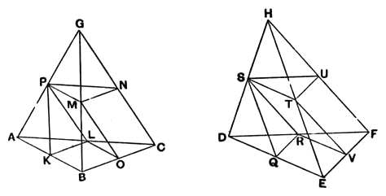

For, since _BO_ is equal to _OC_, and _AL_ to _LC_,
therefore _LO_ is parallel to _AB_,
and the triangle _ABC_ is similar to the triangle _LOC_.

For the same reason
the triangle _DEF_ is also similar to the triangle _RVF_.
And, since _BC_ is double of _CO_, and _EF_ of _FV_,
therefore, as _BC_ is to _CO_, so is _EF_ to _FV_.
And on _BC_, _CO_ are described the similar and similarly
situated rectilineal figures _ABC_, _LOC_,
and on _EF_, _FV_ the similar and similarly situated figures
_DEF_, _RVF_;
therefore, as the triangle _ABC_ is to the triangle _LOC_, so is
the triangle _DEF_ to the triangle _RVF_; [VI. 22]
therefore, alternately, as the triangle _ABC_ is to the triangle
_DEF_, so is the triangle _LOC_ to the triangle _RVF_. [V. 16]
But, as the triangle _LOC_ is to the triangle _RVF_, so is
the prism in which the triangle _LOC_ is the base and _PMN_ its
opposite to the prism in which the triangle _RVF_ is the base
and _STU_ its opposite; [Lemma following]
therefore also, as the triangle _ABC_ is to the triangle _DEF_,
so is the prism in which the triangle _LOC_ is the base and
_PMN_ its opposite to the prism in which the triangle _RVF_
is the base and _STU_ its opposite.
But, as the said prisms are to one another, so is the prism
in which the parallelogram _KBOL_ is the base and the straight
line _PM_ its opposite to the prism in which the parallelogram
_QEVR_ is the base and the straight line _ST_ its opposite.
[XI. 39; cf. XII. 3]
