For, since $BO$ is equal to $OC$, and $AL$ to $LC$,

therefore $LO$ is parallel to $AB$, 
and the triangle ">$ABC$ is similar to the triangle ">$LOC$.

For the same reason 
the triangle ">$DEF$ is also similar to the triangle ">$RVF$.

And, since $BC$ is double of $CO$, and $EF$ of $FV$,

therefore, as $BC$ is to $CO$, so is $EF$ to $FV$.

And on $BC$, $CO$ are described the similar and similarly 
situated rectilineal figures ">$ABC$, ">$LOC$, 
and on $EF$, $FV$ the similar and similarly situated figures 
">$DEF$, ">$RVF$;

therefore, as the triangle ">$ABC$ is to the triangle ">$LOC$, so is 
the triangle ">$DEF$ to the triangle ">$RVF$; [VI. 22] 
therefore, alternately, as the triangle ">$ABC$ is to the triangle 
">$DEF$, so is the triangle ">$LOC$ to the triangle ">$RVF$. [V. 16]

But, as the triangle ">$LOC$ is to the triangle ">$RVF$, so is 
the prism in which the triangle ">$LOC$ is the base and ">$PMN$ its 
opposite to the prism in which the triangle ">$RVF$ is the base 
and ">$STU$ its opposite; [Lemma following]

therefore also, as the triangle ">$ABC$ is to the triangle ">$DEF$, 
so is the prism in which the triangle ">$LOC$ is the base and 
">$PMN$ its opposite to the prism in which the triangle ">$RVF$ 
is the base and ">$STU$ its opposite.

But, as the said prisms are to one another, so is the prism 
in which the parallelogram ">$KBOL$ is the base and the straight 
line $PM$ its opposite to the prism in which the parallelogram 
">$QEVR$ is the base and the straight line $ST$ its opposite. 
[XI. 39; cf. XII. 3]

