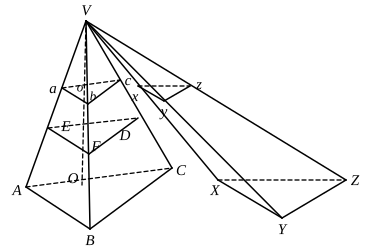

II. Suppose, if possible, that $W > P'$. 
Then, inversely,
$$B' : B = W : P$$
$$= P' : V\text{,}$$
where $V$ is some solid less than $P$. [Cf. XII. 2, Lemma, and note.] 
But this can be proved impossible exactly as in Part I. 

Therefore $W$ is neither less nor greater than $P'$, 
so that
$$B : B' = P : P'.$$

Legendre, followed by the American editors already mentioned, and by 
others, approaches the subject by a different route, proving the following 
propositions.

1. <em>If a pyramid be cut by a plane parallel to the base, (a) the lateral edges 
and the height will be cut in the same proportion, (b) the section by the plane 
will be a polygon similar to the base.</em>

(a) Since a lateral face ">$VAB$ of the pyramid ">$V(ABCDE)$ is cut by two 
parallel planes in $AB$, $ab$,

$AB$ $\parallel$ $ab$;

Similarly $BC$ $\parallel$ $bc$, and so on. 
Therefore

$VA$ $:$ $Va$ $=$ $VB$ $:$ $Vb$ $=$ $VC$ $:$ $Vc$ $= \dots.$

And, if $VO$ the height be cut in $O$, $o$, 

$BO$ $\parallel$ $bo$; and each of the above ratios is equal to $VO$ $:$ $Vo$.

(b) Since $BA$ $\parallel$ $ba$, and $BC$ $\parallel$ $bc$,

$\angle$$ABC$ $= \angle$$abc$. [XI. 10]

Similarly for all the other angles of the polygons, which are therefore 
equiangular. 
Also, by similar triangles,

$VA$ $:$ $Va$ $=$ $AB$ $:$ $ab$,

and so on. 
Therefore, by the ratios above,

$AB$ $:$ $ab$ $=$ $BC$ $:$ $bc$ $= \dots.$

Therefore the polygons are similar.

2. <em>If two pyramids of the same height be cut by planes which are at the 
same perpendicular distance from the vertices, the sections are as the respective 
bases.</em>

