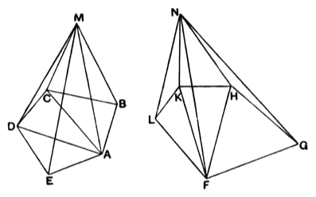

### PROPOSITION 6.

*Pyramids which are of the same height and have polygonal bases are to one another as the bases.*

Let there be pyramids of the same height of which the polygons $ABCDE$, $FGHKL$ are the bases and the points $M$, $N$ the vertices;
I say that, as the base $ABCDE$ is to the base $FGHKL$, so is the pyramid $ABCDEM$ to the pyramid $FGHKLN$.

For let $AC$, $AD$, $FH$, $FK$ be joined.

Since then $ABCM$, $ACDM$ are two pyramids which have triangular bases and equal height,
they are to one another as the bases; [XII. 5]
therefore, as the base $ABC$ is to the base $ACD$, so is the pyramid $ABCM$ to the pyramid $ACDM$.

And, *componendo*, as the base $ABCD$ is to the base $ACD$, so is the pyramid $ABCDM$ to the pyramid $ACDM$. [V. 18]

But also, as the base $ACD$ is to the base $ADE$, so is the pyramid $ACDM$ to the pyramid $ADEM$. [XII. 5]

Therefore, *ex aequali*, as the base $ABCD$ is to the base $ADE$, so is the pyramid $ABCDM$ to the pyramid $ADEM$. [V. 22]

And again *componendo*, as the base $ABCDE$ is to the base $ADE$, so is the pyramid $ABCDEM$ to the pyramid $ADEM$. [V. 18]

Similarly also it can be proved that, as the base $FGHKL$ is to the base $FGH$, so is the pyramid $FGHKLN$ to the pyramid $FGHN$.
