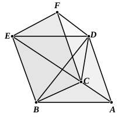

### PROPOSITION 7.

*Any prism which has a triangular base is divided into three pyramids equal to one another which have triangular bases.*

Let there be a prism in which the triangle ">$ABC$ is the base and ">$DEF$ its opposite;
I say that the prism ">$ABCDEF$ is divided into three pyramids equal to one another, which have triangular bases.

For let $BD$, $EC$, $CD$ be joined.

Since ">$ABED$ is a parallelogram, and $BD$ is its diameter, therefore the triangle ">$ABD$ is equal to the triangle ">$EBD$; [I. 34]
therefore also the pyramid of which the triangle ">$ABD$ is the base and the point $C$ the vertex is equal to the pyramid of which the triangle ">$DEB$ is the base and the point $C$ the vertex. [XII. 5]

But the pyramid of which the triangle ">$DEB$ is the base and the point $C$ the vertex is the same with the pyramid of which the triangle ">$EBC$ is the base and the point $D$ the vertex;
for they are contained by the same planes.

Therefore the pyramid of which the triangle ">$ABD$ is the base and the point $C$ the vertex is also equal to the pyramid of which the triangle ">$EBC$ is the base and the point $D$ the vertex.

Again, since ">$FCBE$ is a parallelogram, and $CE$ is its diameter, the triangle ">$CEF$ is equal to the triangle ">$CBE$. [I. 34]

Therefore also the pyramid of which the triangle ">$BCE$ is the base and the point $D$ the vertex is equal to the pyramid of which the triangle ">$ECF$ is the base and the point $D$ the vertex. [XII. 5]

But the pyramid of which the triangle ">$BCE$ is the base and the point $D$ the vertex was proved equal to the pyramid of which the triangle ">$ABD$ is the base and the point $C$ the vertex;
