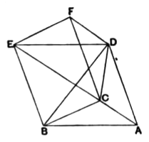

### PROPOSITION 7.

*Any prism which has a triangular base is divided into three pyramids equal to one another which have triangular bases.*

Let there be a prism in which the triangle *ABC* is the base and *DEF* its opposite;
I say that the prism *ABCDEF* is divided into three pyramids equal to one another, which have triangular bases.

For let *BD*, *EC*, *CD* be joined.

Since *ABED* is a parallelogram, and *BD* is its diameter, therefore the triangle *ABD* is equal to the triangle *EBD*; [I. 34]
therefore also the pyramid of which the triangle *ABD* is the base and the point *C* the vertex is equal to the pyramid of which the triangle *DEB* is the base and the point *C* the vertex. [XII. 5]

But the pyramid of which the triangle *DEB* is the base and the point *C* the vertex is the same with the pyramid of which the triangle *EBC* is the base and the point *D* the vertex;
for they are contained by the same planes.

Therefore the pyramid of which the triangle *ABD* is the base and the point *C* the vertex is also equal to the pyramid of which the triangle *EBC* is the base and the point *D* the vertex.

Again, since *FCBE* is a parallelogram, and *CE* is its diameter, the triangle *CEF* is equal to the triangle *CBE*. [I. 34]

Therefore also the pyramid of which the triangle *BCE* is the base and the point *D* the vertex is equal to the pyramid of which the triangle *ECF* is the base and the point *D* the vertex. [XII. 5]

But the pyramid of which the triangle *BCE* is the base and the point *D* the vertex was proved equal to the pyramid of which the triangle *ABD* is the base and the point *C* the vertex;
