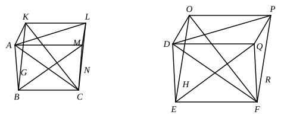

which the triangles ">$ABC$, ">$DEF$ are the bases and the points $G$, $H$ the vertices;
I say that the pyramid ">$ABCG$ has to the pyramid ">$DEFH$ the ratio triplicate of that which $BC$ has to $EF$.

For let the parallelepipedal solids ">$BGML$, ">$EHQP$ be completed.

Now, since the pyramid ">$ABCG$ is similar to the pyramid ">$DEFH$, therefore the angle $ABC$ is equal to the angle $DEF$,
the angle $GBC$ to the angle $HEF$,
and the angle $ABG$ to the angle $DEH$;
and, as $AB$ is to $DE$, so is $BC$ to $EF$, and $BG$ to $EH$.

And since, as $AB$ is to $DE$, so is $BC$ to $EF$, and the sides are proportional about equal angles, therefore the parallelogram ">$BM$ is similar to the parallelogram ">$EQ$.

For the same reason ">$BN$ is also similar to ">$ER$, and ">$BK$ to ">$EO$;
therefore the three parallelograms ">$MB$, ">$BK$, ">$BN$ are similar to the three ">$EQ$, ">$EO$, ">$ER$.

But the three parallelograms ">$MB$, ">$BK$, ">$BN$ are equal and similar to their three opposites, and the three ">$EQ$, ">$EO$, ">$ER$ are equal and similar to their three opposites. [XI. 24]

Therefore the solids ">$BGML$, ">$EHQP$ are contained by similar planes equal in multitude.

Therefore the solid ">$BGML$ is similar to the solid ">$EHQP$.

But similar parallelepipedal solids are in the triplicate ratio of their corresponding sides. [XI. 33]
