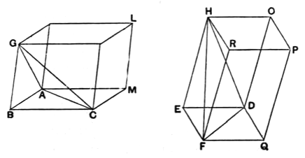

### PROPOSITION 9.

*In equal pyramids which have triangular bases the bases are reciprocally proportional to the heights; and those pyramids in which the bases are reciprocally proportional to the heights are equal.*

For let there be equal pyramids which have the triangular bases *ABC*, *DEF* and vertices the points *G*, *H*;
I say that in the pyramids *ABCG*, *DEFH* the bases are reciprocally proportional to the heights, that is, as the base *ABC* is to the base *DEF*, so is the height of the pyramid *DEFH* to the height of the pyramid *ABCG*.

For let the parallelepipedal solids *BGML*, *EHQP* be completed.

Now, since the pyramid *ABCG* is equal to the pyramid *DEFH*, and the solid *BGML* is six times the pyramid *ABCG*, and the solid *EHQP* six times the pyramid *DEFH*, therefore the solid *BGML* is equal to the solid *EHQP*.

But in equal parallelepipedal solids the bases are reciprocally proportional to the heights; [XI. 34]
therefore, as the base *BM* is to the base *EQ*, so is the height of the solid *EHQP* to the height of the solid *BGML*.

But, as the base *BM* is to *EQ*, so is the triangle *ABC* to the triangle *DEF*. [I. 34]

Therefore also, as the triangle *ABC* is to the triangle *DEF*, so is the height of the solid *EHQP* to the height of the solid *BGML*. [V. 11]
