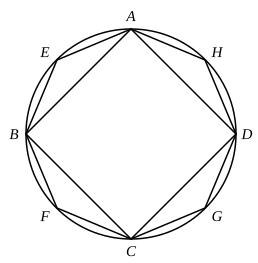

therefore the pyramid ">$ABCG$ is equal to the pyramid ">$DEFH$.

Therefore etc.

Q. E. D.

---

The volumes of the pyramids are respectively one sixth part of the volumes of the parallelepipeds described, as in the figure, on double the bases and with the same heights as the pyramids.

I. Thus the parallelepipeds are equal if the pyramids are equal.
And, the parallelepipeds being equal, their bases are reciprocally proportional to their heights; [XI. 34]
hence the bases of the equal pyramids (which are the halves of the bases of the parallelepipeds) are proportional to their heights.

II. If the bases of the pyramids are reciprocally proportional to their heights, so are the bases of the parallelepipeds to their heights (since the bases of the parallelepipeds are double of the bases of the pyramids respectively).
Consequently the parallelepipeds are equal. [XI. 34]
Therefore their sixth parts, the pyramids, are also equal.

---

### PROPOSITION 10.

*Any cone is a third part of the cylinder which has the same base with it and equal height.*

For let a cone have the same base, namely the circle $ABCD$, with a cylinder and equal height;
I say that the cone is a third part of the cylinder, that is, that the cylinder is triple of the cone.

For if the cylinder is not triple of the cone, the cylinder will be either greater than triple or less than triple of the cone.

First let it be greater than triple, and let the square ">$ABCD$ be inscribed in the circle $ABCD$; [IV. 6]
then the square ">$ABCD$ is greater than the half of the circle $ABCD$.

From the square ">$ABCD$ let there be set up a prism of equal height with the cylinder.
Then the prism so set up is greater than the half of the cylinder,
