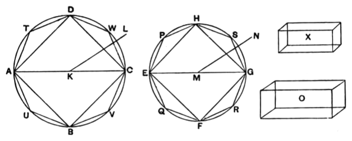

### PROPOSITION 11.

*Cones and cylinders which are of the same height are to one another as their bases.*

Let there be cones and cylinders of the same height,  
let the circles *ABCD*, *EFGH* be their bases, *KL*, *MN* their axes and *AC*, *EG* the diameters of their bases;  
I say that, as the circle *ABCD* is to the circle *EFGH*, so is the cone *AL* to the cone *EN*.

For, if not, then, as the circle *ABCD* is to the circle *EFGH*, so will the cone *AL* be either to some solid less than the cone *EN* or to a greater.

First, let it be in that ratio to a less solid *O*, and let the solid *X* be equal to that by which the solid *O* is less than the cone *EN*;  
therefore the cone *EN* is equal to the solids *O*, *X*.

Let the square *EFGH* be inscribed in the circle *EFGH*;  
therefore the square is greater than the half of the circle.

Let there be set up from the square *EFGH* a pyramid of equal height with the cone;  
therefore the pyramid so set up is greater than the half of the cone,  
inasmuch as, if we circumscribe a square about the circle, and set up from it a pyramid of equal height with the cone, the inscribed pyramid is half of the circumscribed pyramid,  
for they are to one another as their bases, [XII. 6]  
while the cone is less than the circumscribed pyramid.
