### PROPOSITION 12.

*Similar cones and cylinders are to one another in the triplicate ratio of the diameters in their bases.*

Let there be similar cones and cylinders,
let the circles $ABCD$, $EFGH$ be their bases, $BD$, $FH$ the diameters of the bases, and $KL$, $MN$ the axes of the cones and cylinders;
I say that the cone of which the circle $ABCD$ is the base and the point $L$ the vertex has to the cone of which the circle $EFGH$ is the base and the point $N$ the vertex the ratio triplicate of that which $BD$ has to $FH$.

For, if the cone ">$ABCDL$ has not to the cone ">$EFGHN$ the ratio triplicate of that which $BD$ has to $FH$, the cone ">$ABCDL$ will have that triplicate ratio either to some solid less than the cone ">$EFGHN$ or to a greater.

First, let it have that triplicate ratio to a less solid $O$.

Let the square ">$EFGH$ be inscribed in the circle $EFGH$; [^410_1]
therefore the square ">$EFGH$ is greater than the half of the circle $EFGH$.

Now let there be set up on the square ">$EFGH$ a pyramid having the same vertex with the cone;
therefore the pyramid so set up is greater than the half part of the cone.

[^410_1]: [IV. 6]
