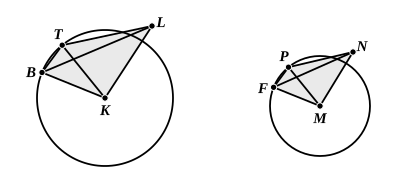

Therefore the cone ">$ABCDL$ has not to any solid greater 
than the cone ">$EFGHN$ the ratio triplicate of that which $BD$ 
has to $FH$.

But it was proved that neither has it this ratio to a less 
solid than the cone ">$EFGHN$.

Therefore the cone ">$ABCDL$ has to the cone ">$EFGHN$ 
the ratio triplicate of that which $BD$ has to $FH$.

But, as the cone is to the cone, so is the cylinder to the 
cylinder, 
for the cylinder which is on the same base as the cone and 
of equal height with it is triple of the cone; [XII. 10]

therefore the cylinder also has to the cylinder the ratio 
triplicate of that which $BD$ has to $FH$.

Therefore etc.Q. E. D.

---

The method of proof is precisely that of the previous proposition. The 
only addition is caused by the necessity of proving that, if similar equilateral 
polygons be inscribed in the bases of two similar cones, and pyramids be 
erected on them with the same vertices as those of the cones, the pyramids 
(are similar and) are to one another in the triplicate ratio of corresponding 
edges.

Let $KL$, $MN$ be the axes of the cones, $L$, $N$ the vertices, and let $BT$, $FP$ 
be sides of similar polygons inscribed in the bases. Join $BK$, $TK$, $BL$, $TL$, 
$PM$, $FM$, $PN$, $FN$.

Now ">$BKL$, ">$FMN$ are right-angled triangles, and, since the cones are 
similar, 
$BK$ : $KL$ = $FM$ : $MN$. [XI. Def. 24]

Therefore (1) $\Delta$s ">$BKL$, ">$FMN$ are similar. [VI. 6] 
Similarly (2) $\Delta$s ">$TKL$, ">$PMN$ are similar.

Next, in $\Delta$s ">$BKT$, ">$FMP$, the angles $BKT$, $FMP$ are equal, since each is 
the same fraction of four right angles; and the sides about the equal angles are 
proportional; 
therefore (3) $\Delta$s ">$BKT$, ">$FMP$ are similar.
