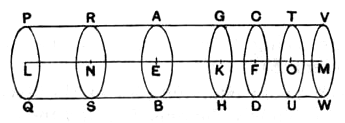

II. Suppose, if possible, that
$$(\text{ratio triplicate of } d : d') = X : O,$$
where $O$ is *greater* than $X'$;
then
$$(\text{ratio triplicate of } d : d') = Z : X',$$
or, inversely,
$$(\text{ratio triplicate of } d' : d) = X' : Z,$$
where $Z$ is *some solid less than* $X$.

This is proved impossible by the exact method of Part I.

Hence $O$ cannot be either greater or less than $X'$,
and
$$X : X' = (\text{ratio triplicate of ratio } d : d').$$

---

### PROPOSITION 13.

*If a cylinder be cut by a plane which is parallel to its opposite planes, then, as the cylinder is to the cylinder, so will the axis be to the axis.*

For let the cylinder *AD* be cut by the plane *GH* which is parallel to the opposite planes *AB*, *CD*,
and let the plane *GH* meet the axis at the point *K*;
I say that, as the cylinder *BG* is to the cylinder *GD*, so is the axis *EK* to the axis *KF*.

For let the axis *EF* be produced in both directions to the points *L*, *M*,
and let there be set out any number whatever of axes *EN*, *NL* equal to the axis *EK*,
and any number whatever *FO*, *OM* equal to *FK*;
and let the cylinder *PW* on the axis *LM* be conceived of which the circles *PQ*, *VW* are the bases.

Let planes be carried through the points *N*, *O* parallel to *AB*, *CD* and to the bases of the cylinder *PW*,
and let them produce the circles *RS*, *TU* about the centres *N*, *O*.

Then, since the axes *LN*, *NE*, *EK* are equal to one another,
