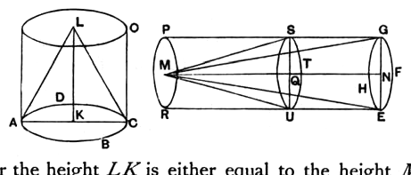

### PROPOSITION 15.

*In equal cones and cylinders the bases are reciprocally proportional to the heights; and those cones and cylinders in which the bases are reciprocally proportional to the heights are equal.*

    Let there be equal cones and cylinders of which the circles *ABCD, EFGH* are the bases;
let *AC, EG* be the diameters of the bases,
and *KL, MN* the axes, which are also the heights of the cones or cylinders;
let the cylinders *AO, EP* be completed.
    I say that in the cylinders *AO, EP* the bases are reciprocally proportional to the heights,
that is, as the base *ABCD* is to the base *EFGH*, so is the height *MN* to the height *KL*.

    For the height *LK* is either equal to the height *MN* or not equal.
    First, let it be equal.
    Now the cylinder *AO* is also equal to the cylinder *EP*.
    But cones and cylinders which are of the same height are to one another as their bases; [XII. 11]
therefore the base *ABCD* is also equal to the base *EFGH*.
    Hence also, reciprocally, as the base *ABCD* is to the base *EFGH*, so is the height *MN* to the height *KL*.
    Next, let the height *LK* not be equal to *MN*,
but let *MN* be greater;
from the height *MN* let *QN* be cut off equal to *KL*,
through the point *Q* let the cylinder *EP* be cut by the plane *TUS* parallel to the planes of the circles *EFGH, RP*,
