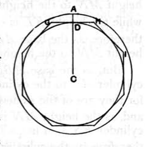

    Therefore the cylinder *AO* is equal to the cylinder *EP*. [v. 9]
    And the same is true for the cones also.

Q. E. D.

---

**I.** If the heights of the two cylinders are equal, and their volumes are equal, the bases are equal, since the latter are proportional to the volumes. [XII. 11]
    If the heights are *not* equal, cut off from the higher cylinder a cylinder of the same height as the lower.
    Then, if *LK, QN* be the equal heights,
we have, by **XII. 11**,
$$\begin{aligned}
(\text{base } ABCD) : (\text{base } EFGH) &= (\text{cylinder } AO) : (\text{cylinder } ES) \\
&= (\text{cylinder } EP) : (\text{cylinder } ES)\text{, by hypothesis,} \\
&= MN : QN \tag{XII. 13} \\
&= MN : KL.
\end{aligned}$$

**II.** In the converse part of the proposition, Euclid omits the case where the cylinders have equal heights. In this case of course the reciprocal ratios are both ratios of equality; the bases are therefore equal, and consequently the cylinders.
    If the heights are *not* equal, we have, with the same construction as before,
$$(\text{base } ABCD) : (\text{base } EFGH) = MN : KL.$$
    But [**XII. 11**]
$$(\text{base } ABCD) : (\text{base } EFGH) = (\text{cylinder } AO) : (\text{cylinder } ES)\text{,}$$
and
$$\begin{aligned}
MN : KL &= MN : QN \\
&= (\text{cylinder } EP) : (\text{cylinder } ES). \tag{XII. 13}
\end{aligned}$$
    Therefore
$$(\text{cylinder } AO) : (\text{cylinder } ES) = (\text{cylinder } EP) : (\text{cylinder } ES)\text{,}$$
and consequently
$$(\text{cylinder } AO) = (\text{cylinder } EP).$$
    Similarly for the cones, which are equal to one-third of the cylinders respectively.
    Legendre deduces these propositions about cones and cylinders from two others which he establishes by a method similar to that adopted by him for the theorem of **XII. 2** (see note on that proposition).
    The first (for the cylinder) is as follows.
    *The volume of a cylinder is equal to the product of its base by its height.*
    Suppose *CA* to be the radius of the base of the given cylinder, *h* its height.
    For brevity let us denote by $(\text{surf. } CA)$ the area of the circle of which *CA* is the radius.
    If $(\text{surf. } CA) \times h$ is not the measure of the given cylinder, it will be the measure of a cylinder greater or less than it.

    **I.** First let it be the measure of a less cylinder, that, for example, of which the circle with radius *CD* is the base, and *h* is the height.
