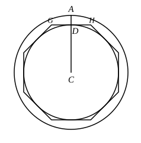

Therefore the cylinder ">$AO$ is equal to the cylinder ">$EP$. [v. 9] 
And the same is true for the cones also.

Q. E. D.

---

**I.** If the heights of the two cylinders are equal, and their volumes are 
equal, the bases are equal, since the latter are proportional to the volumes. 
[XII. 11] 
If the heights are *not* equal, cut off from the higher cylinder a cylinder of 
the same height as the lower. 
Then, if $LK$, $QN$ be the equal heights, 
we have, by XII. 11, 
(base $ABCD$) : (base $EFGH$) = (cylinder ">$AO$) : (cylinder ">$ES$) 
= (cylinder ">$EP$) : (cylinder ">$ES$), 
by hypothesis, 
= $MN$ : $QN$ [XII. 13] 
= $MN$ : $KL$.

**II.** In the converse part of the proposition, Euclid omits the case where 
the cylinders have equal heights. In this case of course the reciprocal ratios 
are both ratios of equality; the bases are therefore equal, and consequently the 
cylinders. 
If the heights are *not* equal, we have, with the same construction as before, 
(base $ABCD$) : (base $EFGH$) = $MN$ : $KL$. 
But [XII. 11] 
(base $ABCD$) : (base $EFGH$) = (cylinder ">$AO$) : (cylinder ">$ES$), 
and 
$MN$ : $KL$ = $MN$ : $QN$ 
= (cylinder ">$EP$) : (cylinder ">$ES$). [XII. 13] 
Therefore 
(cylinder ">$AO$) : (cylinder ">$ES$) = (cylinder ">$EP$) : (cylinder ">$ES$), 
and consequently 
(cylinder ">$AO$) = (cylinder ">$EP$).

Similarly for the cones, which are equal to one-third of the cylinders 
respectively.

Legendre deduces these propositions about cones and cylinders from two 
others which he establishes by a method similar 
to that adopted by him for the theorem of XII. 2 
(see note on that proposition). 
The first (for the cylinder) is as follows. 
*The volume of a cylinder is equal to the 
product of its base by its height.* 
Suppose $CA$ to be the radius of the base of 
the given cylinder, $h$ its height. 
For brevity let us denote by (surf. $CA$) the 
area of the circle of which $CA$ is the radius. 
If (surf. $CA$) $\times h$ is not the measure of the 
given cylinder, it will be the measure of a 
cylinder greater or less than it.

**I.** First let it be the measure of a less 
cylinder, that, for example, of which the circle with radius $CD$ is the base, and 
$h$ is the height.
