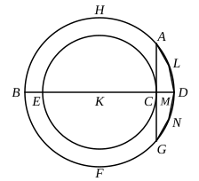

Let $ABCD$, $EFGH$ be the two given circles about the 
same centre $K$ ; 
thus it is required to inscribe in the 
greater circle $ABCD$ an equilateral 
polygon with an even number of 
sides which does not touch the circle 
$EFGH$.

For let the straight line $BKD$ 
be drawn through the centre $K$, 
and from the point $G$ let $GA$ be 
drawn at right angles to the straight 
line $BD$ and carried through to $C$ ;

therefore $AC$ touches the circle $EFGH$. [III. 16, Por.]

Then, bisecting the circumference $BAD$, bisecting the 
half of it, and doing this continually, we shall leave a circum- 
ference less than $AD$. [X. 1] 
Let such be left, and let it be $LD$ ; 
from $L$ let $LM$ be drawn perpendicular to $BD$ and carried 
through to $N$, 
and let $LD$, $DN$ be joined ;

therefore $LD$ is equal to $DN$. [III. 3, I. 4]

Now, since $LN$ is parallel to $AC$, 
and $AC$ touches the circle $EFGH$,

therefore $LN$ does not touch the circle $EFGH$ ; 
therefore $LD$, $DN$ are far from touching the circle $EFGH$.

If then we fit into the circle $ABCD$ straight lines equal 
to the straight line $LD$ and placed continuously, there will 
be inscribed in the circle $ABCD$ an equilateral polygon with 
an even number of sides which does not touch the lesser 
circle $EFGH$.Q. E. F.

---

It must be carefully observed that the polygon inscribed in the outer circle 
in this proposition is such that not only do its own sides not touch the inner 
circle, but also *the chords, as $LN$, joining angular points next but one to each 
other do not touch the inner circle either*. In other words, the polygon is the 
second in order, not the first, which satisfies the condition of the enunciation. 
This is important, because such a polygon is wanted in the next proposition ; 
hence in that proposition the *exact* construction here given must be followed.
