therefore any one of the equal angles is greater than a right angle, i.e. $\angle$ $BXK$ is obtuse.

Therefore (3) $BK^2$ $>$ 2 $BX^2$. [II. 12]

Next, consider the semicircle $BKD$ with $KZ$ drawn perpendicular to $BD$.

We have $BD$ $<$ 2 $DZ$,
so that $DB$ . $BZ$ $<$ 2 $DZ$ . $ZB$,
or $BK^2$ $<$ 2 $KZ^2$;
therefore, *a fortiori*, [by (3) above]
(4) $BX^2$ $<$ $KZ^2$.

Now $AK^2$ = $AB^2$;
therefore $AZ^2$ + $ZK^2$ = $AX^2$ + $XB^2$.

And $BX^2$ $<$ $KZ^2$;
therefore $AX^2$ $>$ $AZ^2$,
or (5) $AX$ $>$ $AZ$.

But, by the construction in XII. 16, $AZ$ $>$ $AG$; therefore, *a fortiori*,
$AX$ $>$ $AG$.

And, since the perpendicular $AX$ is the shortest distance from $A$ to the plane ">$BPSK$,
(6) the plane ">$BPSK$ does not anywhere meet the inner sphere.

Euclid omits to prove that, *a fortiori*, the other quadrilaterals ">$PQTS$, ">$QRUT$, and the triangle ">$ROU$, do not anywhere meet the inner sphere.

For this purpose it is only necessary to show that the radii of the circles circumscribing ">$BPSK$, ">$PQTS$, ">$QRUT$ and ">$ROU$ are in descending order of magnitude.

We have therefore to prove that, if ">$ABCD$, ">$A'B'C'D'$ are two quadrilaterals inscribable in circles, and
$AD$ = $BC$ = $A'D'$ = $B'C'$,
while $AB$ is not greater than $AD$, $A'B'$ = $CD$, and $AB$ $>$ $CD$ $>$ $C'D'$,
then the radius $OA$ of the circle circumscribing the first quadrilateral is greater than the radius $O'A'$ of the circle circumscribing the second.

Clavius, and Simson after him, prove this by *reductio ad absurdum*.

(1) *If $OA$ = $O'A'$*,
it follows that $\angle s$ $AOD$, $BOC$, $A'O'D'$, $B'O'C'$ are all equal.

Also $\angle$ $AOB$ $>$ $\angle$ $A'O'B'$,
$\angle$ $COD$ $>$ $\angle$ $C'O'D'$,
whence the four angles about $O$ are together greater than the four angles about $O'$, i.e. greater than four right angles;
which is impossible.
