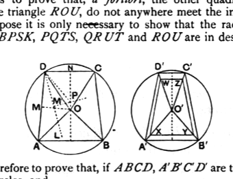

therefore any one of the equal angles is greater than a right angle, i.e. $\angle BXK$ is obtuse.

Therefore (3) $BK^2 > 2 BX^2$. [II. 12]

Next, consider the semicircle $BKD$ with $KZ$ drawn perpendicular to $BD$.

We have $BD < 2 DZ$,
so that $DB . BZ < 2 DZ . ZB$,
or $BK^2 < 2 KZ^2$;
therefore, *a fortiori*, [by (3) above]
(4) $BX^2 < KZ^2$.

Now $AK^2 = AB^2$;
therefore $AZ^2 + ZK^2 = AX^2 + XB^2$.

And $BX^2 < KZ^2$;
therefore $AX^2 > AZ^2$,
or (5) $AX > AZ$.

But, by the construction in XII. 16, $AZ > AG$; therefore, *a fortiori*,
$AX > AG$.

And, since the perpendicular $AX$ is the shortest distance from $A$ to the plane $BPSK$,
(6) the plane $BPSK$ does not anywhere meet the inner sphere.

Euclid omits to prove that, *a fortiori*, the other quadrilaterals $PQTS$, $QRUT$, and the triangle $ROU$, do not anywhere meet the inner sphere.

For this purpose it is only necessary to show that the radii of the circles circumscribing $BPSK, PQTS, QRUT$ and $ROU$ are in descending order of magnitude.

We have therefore to prove that, if $ABCD, A'B'C'D'$ are two quadrilaterals inscribable in circles, and
$AD = BC = A'D' = B'C'$,
while $AB$ is not greater than $AD, A'B' = CD$, and $AB > CD > C'D'$,
then the radius $OA$ of the circle circumscribing the first quadrilateral is greater than the radius $O'A'$ of the circle circumscribing the second.

Clavius, and Simson after him, prove this by *reductio ad absurdum*.

(1) *If $OA = O'A'$*,
it follows that $\angle s$ $AOD, BOC, A'O'D', B'O'C'$ are all equal.

Also $\angle AOB > \angle A'O'B'$,
$\angle COD > \angle C'O'D'$,
whence the four angles about $O$ are together greater than the four angles about $O'$, i.e. greater than four right angles;
which is impossible.
