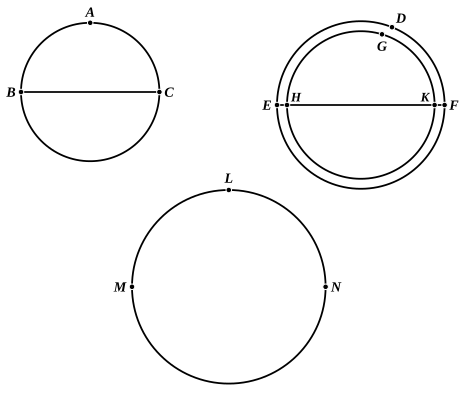

and let there also be inscribed in the sphere $ABC$ a polyhedral solid similar to the polyhedral solid in the sphere $DEF$;
therefore the polyhedral solid in $ABC$ has to the polyhedral solid in $DEF$ the ratio triplicate of that which $BC$ has to $EF$. [XII. 17, Por.]

But the sphere $ABC$ also has to the sphere $GHK$ the ratio triplicate of that which $BC$ has to $EF$;
therefore, as the sphere $ABC$ is to the sphere $GHK$, so is the polyhedral solid in the sphere $ABC$ to the polyhedral solid in the sphere $DEF$;
and, alternately, as the sphere $ABC$ is to the polyhedron in it, so is the sphere $GHK$ to the polyhedral solid in the sphere $DEF$. [V. 16]

But the sphere $ABC$ is greater than the polyhedron in it;
therefore the sphere $GHK$ is also greater than the polyhedron in the sphere $DEF$.

But it is also less,
for it is enclosed by it.

Therefore the sphere $ABC$ has not to a less sphere than the sphere $DEF$ the ratio triplicate of that which the diameter $BC$ has to $EF$.
