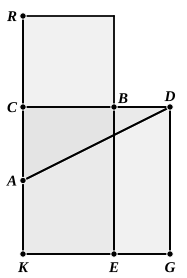

Subtract from each side the sq. on *AC*; then

(gnomon <i>MNO</i>) = 4 (sq. on <i>AC</i>) 
= (sq. on <i>CD</i>).

Now, as in the last proposition,

□ <i>CE</i> = 2 (□ <i>BH</i>) 
= □ <i>BH</i> + □ <i>HL</i>.

Subtracting these equals from the equals, the square on *CD* and the gnomon *MNO* respectively, we have

□ <i>BG</i> = (square <i>HF</i>),

i.e.

(rect. <i>CD</i>, <i>DB</i>) = (sq. on <i>CB</i>).

Here again the proposition can readily be proved by means of a figure similar to that of II. 11.

Draw *CA* through *C* at *right angles* to *CB* and of length equal to *CA* in the original figure; make *CD* double of *CA*; produce *AC* to *R* so that $CR = CB$.

Complete the squares on *CB* and *CD*, and join *AD*.

Now we are given the fact that

(sq. on <i>AR</i>) = 5 (sq. on <i>CA</i>).

But

5 (sq. on <i>AC</i>) = (sq. on <i>AC</i>) + (sq. on <i>CD</i>) 
= (sq. on <i>AD</i>).

Therefore

(sq. on <i>AR</i>) = (sq. on <i>AD</i>),

or $AR = AD$.

Now

(rect. <i>KR</i>, <i>RC</i>) + (sq. on <i>AC</i>) = (sq. on <i>AR</i>) 
= (sq. on <i>AD</i>) 
= (sq. on <i>AC</i>) + (sq. on <i>CD</i>).

Therefore

(rect. <i>KR</i> . <i>RC</i>) = (sq. on <i>CD</i>).

That is,

(rectangle <i>RE</i>) = (square <i>CG</i>).

Subtract the common part *CE*, and

(rect. <i>BG</i>) = (sq. <i>RB</i>),

or

rect. <i>CD</i>, <i>DB</i> = (sq. on <i>CB</i>).

Heiberg, with reason, doubts the genuineness of the Lemma following this proposition.

---

### PROPOSITION 3.

*If a straight line be cut in extreme and mean ratio, the square on the lesser segment added to the half of the greater segment is five times the square on the half of the greater segment.*
