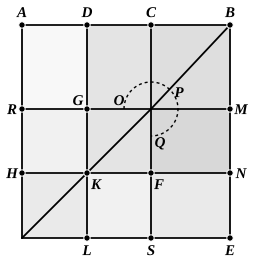

For let any straight line $AB$ be cut in extreme and mean 
ratio at the point $C$, 
let $AC$ be the greater segment, 
and let $AC$ be bisected at $D$ ; 
I say that the square on $BD$ is 
five times the square on $DC$.

For let the square ">$AE$ be 
described on $AB$, 
and let the figure be drawn 
double.

Since $AC$ is double of $DC$,

therefore the square on $AC$ is 
quadruple of the square on $DC$, 
that is, ">$RS$ is quadruple of ">$FG$.

And, since the rectangle $AB$, $BC$ is equal to the square 
on $AC$, 
and ">$CE$ is the rectangle $AB$, $BC$,

therefore ">$CE$ is equal to ">$RS$.

But ">$RS$ is quadruple of ">$FG$ ;

therefore ">$CE$ is also quadruple of ">$FG$.

Again, since $AD$ is equal to $DC$,

$HK$ is also equal to $KF$.

Hence the square ">$GF$ is also equal to the square ">$HL$.

Therefore $GK$ is equal to $KL$, that is, $MN$ to $NE$ ; 
hence ">$MF$ is also equal to ">$FE$.

But ">$MF$ is equal to ">$CG$ ;

therefore ">$CG$ is also equal to ">$FE$.

Let ">$CN$ be added to each ;

therefore the gnomon ">$OPQ$ is equal to ">$CE$.

But ">$CE$ was proved quadruple of ">$GF$ ;

therefore the gnomon ">$OPQ$ is also quadruple of the square ">$FG$.

Therefore the gnomon ">$OPQ$ and the square ">$FG$ are 
five times ">$FG$.

But the gnomon ">$OPQ$ and the square ">$FG$ are the 
square ">$DN$.

And ">$DN$ is the square on $DB$, and ">$GF$ the square on $DC$.

Therefore the square on $DB$ is five times the square 
on $DC$.

Q. E. D.

