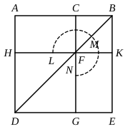

In this case we have
$$\begin{align*}
(\text{sq. on } BD) &= (\text{sq. } FG) + (\text{rect. } CG) + (\text{rect. } CN) \\
&= (\text{sq. } FG) + (\text{rect. } FE) + (\text{rect. } CN) \\
&= (\text{sq. } FG) + (\text{rect. } CE) \\
&= (\text{sq. } FG) + (\text{rect. } AB\text{, } BC) \\
&= (\text{sq. } FG) + (\text{sq. on } AC)\text{, by hypothesis,} \\
&= 5\text{ (sq. on } DC\text{).}
\end{align*}$$

The theorem is still more obvious if the figure of II. 11 be used. Let $CF$ be divided in extreme and mean ratio at $E$, by the method of II. 11.

Then, since
$$\begin{align*}
(\text{rect. } AB\text{, } BC) + (\text{sq. on } CD) &= \text{sq. on } BD \\
&= \text{sqs. on } CD\text{, } CF\text{,} \\
(\text{rect. } AB\text{, } BC) &= (\text{sq. on } CF) \\
&= (\text{sq. on } CA)\text{,}
\end{align*}$$
and $AB$ is divided at $C$ in extreme and mean ratio.

And
$$\begin{align*}
(\text{sq. on } BD) &= (\text{sq. on } DF) \\
&= 5\text{ (sq. on } CD\text{).}
\end{align*}$$

---

### PROPOSITION 4.

*If a straight line be cut in extreme and mean ratio, the square on the whole and the square on the lesser segment together are triple of the square on the greater segment.*

Let $AB$ be a straight line, let it be cut in extreme and mean ratio at $C$, and let $AC$ be the greater segment;
I say that the squares on $AB$, $BC$ are triple of the square on $CA$.

For let the square $ADEB$ be described on $AB$,
and let the figure be drawn.

Since then $AB$ has been cut in extreme and mean ratio at $C$,
and $AC$ is the greater segment,
therefore the rectangle $AB$, $BC$ is equal to the square on $AC$. [VI. Def. 3, VI. 17]

And $AK$ is the rectangle $AB$, $BC$, and $HG$ the square on $AC$;
therefore $AK$ is equal to $HG$.
