And, since ">$AF$ is equal to ">$FE$,
let ">$CK$ be added to each;
therefore the whole ">$AK$ is equal to the whole ">$CE$;
therefore ">$AK$, ">$CE$ are double of ">$AK$.

But ">$AK$, ">$CE$ are the gnomon ">$LMN$ and the square ">$CK$;
therefore the gnomon ">$LMN$ and the square ">$CK$ are double of ">$AK$.

But, further, ">$AK$ was also proved equal to ">$HG$;
therefore the gnomon ">$LMN$ and the squares ">$CK$, ">$HG$ are triple of the square ">$HG$.

And the gnomon ">$LMN$ and the squares ">$CK$, ">$HG$ are the whole square ">$AE$ and ">$CK$, which are the squares on $AB$, $BC$,
while ">$HG$ is the square on $AC$.

Therefore the squares on $AB$, $BC$ are triple of the square on $AC$.

Q. E. D.

---

Here, as in the preceding propositions, the results are proved *de novo* by the method of Book II., without reference to that Book. Otherwise the proof might have been shorter.

For, by II. 7,

(sq. on $AB$) + (sq. on $BC$) = 2 (rect. $AB$, $BC$) + (sq. on $AC$) 
= 3 (sq. on $AC$).

---

### PROPOSITION 5.

*If a straight line be cut in extreme and mean ratio, and there be added to it a straight line equal to the greater segment, the whole straight line has been cut in extreme and mean ratio, and the original straight line is the greater segment.*

Let the straight line $AB$ be cut in extreme and mean ratio at the point $C$,
let $AC$ be the greater segment,
and let $AD$ be equal to $AC$.

I say that the straight line $DB$ has been cut in extreme and mean ratio at $A$, and the original straight line $AB$ is the greater segment.

For let the square ">$AE$ be described on $AB$,
and let the figure be drawn.
