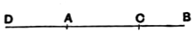

Let $AB$ be a rational straight line,
let it be cut in extreme and mean ratio at $C$,
and let $AC$ be the greater segment;

I say that each of the straight lines $AC$, $CB$ is the irrational straight line called apotome.

For let $BA$ be produced, and let $AD$ be made half of $BA$.

Since then the straight line $AB$ has been cut in extreme and mean ratio,
and to the greater segment $AC$ is added $AD$ which is half of $AB$,
therefore the square on $CD$ is five times the square on $DA$. [XIII. 1]

Therefore the square on $CD$ has to the square on $DA$ the ratio which a number has to a number;
therefore the square on $CD$ is commensurable with the square on $DA$. [X. 6]

But the square on $DA$ is rational,
for $DA$ is rational, being half of $AB$ which is rational;
therefore the square on $CD$ is also rational; [X. Def. 4]
therefore $CD$ is also rational.

And, since the square on $CD$ has not to the square on $DA$ the ratio which a square number has to a square number,
therefore $CD$ is incommensurable in length with $DA$; [X. 9]
therefore $CD$, $DA$ are rational straight lines commensurable in square only;
therefore $AC$ is an apotome. [X. 73]

Again, since $AB$ has been cut in extreme and mean ratio,
and $AC$ is the greater segment,
therefore the rectangle $AB$, $BC$ is equal to the square on $AC$. [VI. Def. 3, VI. 17]

Therefore the square on the apotome $AC$, if applied to the rational straight line $AB$, produces $BC$ as breadth.

But the square on an apotome, if applied to a rational straight line, produces as breadth a first apotome; [X. 97]
therefore $CB$ is a first apotome.
