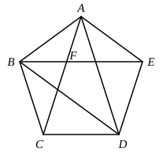

And $CA$ was also proved to be an apotome.

Therefore etc.

Q. E. D.

---

It seems certain that this proposition is an interpolation. P has it, but the copyist (or rather the copyist of its archetype) says that "this theorem is not found in most copies of the new recension, but is found in those of the old." In the first place, there is a scholium to XIII. 17 in P itself which proves the same thing as XIII. 6, and which would therefore have been useless if XIII. 6 had preceded. Hence, when the scholium was written, this proposition had not yet been interpolated. Secondly, P has it before the alternative proof of XIII. 5; this proof is considered, on general grounds, to be interpolated, and it would appear that it must have been a *later* interpolation (XIII. 6) which divorced it from the proposition to which it belonged. Thirdly, there is cause for suspicion in the proposition itself, for, while the enunciation states that each segment of the straight line is an *apotome*, the proposition adds that the lesser segment is a *first apotome*. The scholium in P referred to has not this blot. What is actually wanted in XIII. 17 is the fact that the *greater* segment is an apotome. It is probable that Euclid assumed this fact as evident enough from XIII. 1 without further proof, and that he neither wrote XIII. 6 nor the quotation of its enunciation in XIII. 17.

---

### PROPOSITION 7.

*If three angles of an equilateral pentagon, taken either in order or not in order, be equal, the pentagon will be equiangular.*

For in the equilateral pentagon ">$ABCDE$ let, first, three angles taken in order, those at $A$, $B$, $C$, be equal to one another;

I say that the pentagon ">$ABCDE$ is equiangular.

For let $AC$, $BE$, $FD$ be joined.

Now, since the two sides $CB$, $BA$ are equal to the two sides $BA$, $AE$ respectively,
and the angle $CBA$ is equal to the angle $BAE$,
therefore the base $AC$ is equal to the base $BE$,
the triangle ">$ABC$ is equal to the triangle ">$ABE$,
and the remaining angles will be equal to the remaining angles, namely those which the equal sides subtend, [I. 4]
that is, the angle $BCA$ to the angle $BEA$, and the angle $ABE$ to the angle $CAB$;
hence the side $AF$ is also equal to the side $BF$. [I. 6]
