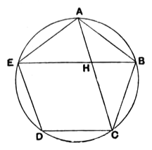

For the same reason
the angle $ABC$ is also equal to the angles at $A$, $C$, $D$.

Therefore the pentagon $ABCDE$ is equiangular.

Q. E. D.

---

This proposition is required in XIII. 17.
The steps of the proof may be shown thus.

I. Suppose that the angles at $A$, $B$, $C$ are all equal.
Then the isosceles triangles $BAE$, $ABC$ are equal in all respects;
thus
$$BE = AC\text{,}\quad \angle BCA = \angle BEA\text{,}\quad \angle CAB = \angle EBA\text{.}$$
By the last equality,
$$FA = FB\text{,}$$
so that, since $BE = AC$,
$$FC = FE\text{.}$$
The $\Delta\text{s } FED$, $FCD$ are now equal in all respects, [I. 8, 4]
and
$$\angle FCD = \angle FED\text{.}$$
But
$$\angle ACB = \angle AEB\text{, from above,}$$
whence, by addition,
$$\angle BCD = \angle AED\text{.}$$
Similarly it may be proved that $\angle CDE$ is also equal to any one of the angles at $A$, $B$, $C$.

II. Suppose the angles at $A$, $C$, $D$ to be equal.
Then the isosceles triangles $ABE$, $CBD$ are equal in all respects, and hence $BE = BD$ (so that $\angle BDE = \angle BED$),
and
$$\angle CDB = \angle AEB\text{.}$$
By addition of the equal angles,
$$\angle CDE = \angle DEA\text{.}$$
Similarly it may be proved that $\angle ABC$ is also equal to each of the angles at $A$, $C$, $D$.

---

### PROPOSITION 8.

*If in an equilateral and equiangular pentagon straight lines subtend two angles taken in order, they cut one another in extreme and mean ratio, and their greater segments are equal to the side of the pentagon.*

For in the equilateral and equiangular pentagon $ABCDE$ let the straight lines $AC$, $BE$, cutting one another at the point $H$, subtend two angles taken in order, the angles at $A$, $B$;

I say that each of them has been cut in extreme and mean ratio at the point $H$, and their greater segments are equal to the side of the pentagon.

For let the circle $ABCDE$ be circumscribed about the pentagon $ABCDE$. [IV. 14]
