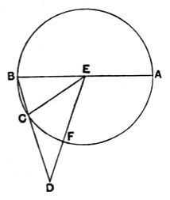

In order to prove this theorem we have to show (1) that the $\Delta\text{s}$ $AEB$, $HAB$ are similar, and (2) that $EH = EA\ (= AB)$.

To prove (2) we have
$$\Delta\text{s } AEB, BAC \text{ equal in all respects,}$$
whence
$$EB = AC,$$
and
$$\angle BAC = \angle ABE.$$

Therefore
$$\begin{aligned}
\angle AHE &= 2\angle BAC \\
&= \angle EAC,
\end{aligned}$$
so that
$$\begin{aligned}
EH &= EA \\
&= AB.
\end{aligned}$$

To prove (1) we have, in the $\Delta\text{s}$ $AEB$, $HAB$,
$$\begin{aligned}
\angle BAH &= \angle EBA \\
&= \angle AEB,
\end{aligned}$$
and
$$\angle ABE \text{ is common,}$$
therefore the third $\angle\text{s}$ $AHB$, $EAB$ are equal,
and
$$\Delta\text{s } AEB, HAB \text{ are similar.}$$

Now, since these triangles are similar,
$$EB : BA = BA : BH,$$
or
$$\begin{aligned}
(\text{rect. } EB, BH) &= (\text{sq. on } BA) \\
&= (\text{sq. on } EH),
\end{aligned}$$
so that $EB$ is divided in extreme and mean ratio at $H$.

Similarly its equal, $CA$, is divided in extreme and mean ratio at $H$.

---

### PROPOSITION 9.

*If the side of the hexagon and that of the decagon inscribed in the same circle be added together, the whole straight line has been cut in extreme and mean ratio, and its greater segment is the side of the hexagon.*

Let *ABC* be a circle;
of the figures inscribed in the circle *ABC* let *BC* be the side of a decagon, *CD* that of a hexagon,
and let them be in a straight line;
I say that the whole straight line *BD* has been cut in extreme and mean ratio, and *CD* is its greater segment.

For let the centre of the circle, the point *E*, be taken,
let *EB*, *EC*, *ED* be joined,
and let *BE* be carried through to *A*.

Since *BC* is the side of an equilateral decagon,
