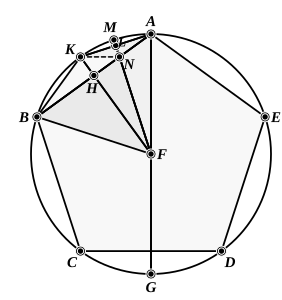

let *AK*, *KB* be joined,
let *FL* be again drawn from *F* perpendicular to *AK*, and be carried through to *M*,
and let *KN* be joined.

Since the circumference *ABCG* is equal to the circumference *AEDG*,
and in them *ABC* is equal to *AED*,
therefore the remainder, the circumference *CG*, is equal to the remainder *GD*.

But *CD* belongs to a pentagon;
therefore *CG* belongs to a decagon.

And, since *FA* is equal to *FB*,
and *FH* is perpendicular,
therefore the angle *AFK* is also equal to the angle *KFB*. [I. 5, I. 26]

Hence the circumference *AK* is also equal to *KB*; [III. 26]
therefore the circumference *AB* is double of the circumference *BK*;
therefore the straight line *AK* is a side of a decagon.

For the same reason
*AK* is also double of *KM*.

Now, since the circumference *AB* is double of the circumference *BK*,
while the circumference *CD* is equal to the circumference *AB*,
therefore the circumference *CD* is also double of the circumference *BK*.

But the circumference *CD* is also double of *CG*;
therefore the circumference *CG* is equal to the circumference *BK*.

But *BK* is double of *KM*, since *KA* is so also;
therefore *CG* is also double of *KM*.
