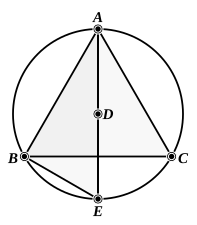

Let $ABC$ be a circle, 
and let the equilateral triangle ">$ABC$ be inscribed in it; 
I say that the square on one side of 
the triangle ">$ABC$ is triple of the square 
on the radius of the circle.

For let the centre $D$ of the circle 
$ABC$ be taken, 
let $AD$ be joined and carried through 
to $E$, 
and let $BE$ be joined.

Then, since the triangle ">$ABC$ is 
equilateral,

therefore the circumference $BEC$ is a third part of the circum- 
ference of the circle $ABC$.

Therefore the circumference $BE$ is a sixth part of the 
circumference of the circle; 
therefore the straight line $BE$ belongs to a hexagon; 
therefore it is equal to the radius $DE$. [IV. 15, Por.]

And, since $AE$ is double of $DE$,

the square on $AE$ is quadruple of the square on $ED$, that is, 
of the square on $BE$.

But the square on $AE$ is equal to the squares on $AB$, $BE$; 
[III. 31, I. 47]

therefore the squares on $AB$, $BE$ are quadruple of the square 
on $BE$.

Therefore, *separando*, the square on $AB$ is triple of the 
square on $BE$.

But $BE$ is equal to $DE$;

therefore the square on $AB$ is triple of the square on $DE$.

Therefore the square on the side of the triangle is triple 
of the square on the radius.

Q. E. D.

---

### PROPOSITION 13.

*To construct a pyramid, to comprehend it in a given sphere, 
and to prove that the square on the diameter of the sphere is 
one and a half times the square on the side of the pyramid.*

